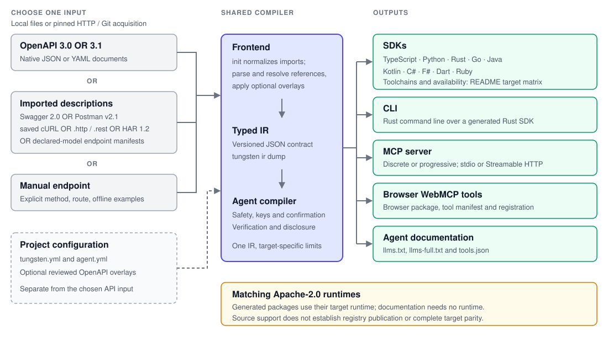

<div align="center">


**Compile an API description — OpenAPI OR Swagger OR Postman OR saved cURL OR HTTP request files OR HAR OR an endpoint manifest — into SDKs, a CLI and an MCP server that AI agents can use safely.**

[](https://ci.boachiefamily.net/repos/4) [](https://github.com/pboachie/tungsten/actions/workflows/ci.yml)
[](https://pboachie.github.io/tungsten/)
[](LICENSE)
[](runtimes/LICENSE)
[](Cargo.toml)

</div>

tungsten is a deterministic compiler written in Rust. It reads one API description — an OpenAPI 3.0 or 3.1 document (JSON or YAML), a Swagger 2.0 document, a Postman Collection v2.1 file, a saved cURL command, an HTTP request file (`.http`/`.rest`), a HAR 1.2 capture or an endpoint manifest with JSON Schema 2020-12 models, each parsed offline — plus two small manifests, builds one typed intermediate representation (IR), and emits TypeScript, Python, Rust, Go, Java, Kotlin, C#, F#, Dart and Ruby SDKs, a Rust command-line client, an MCP server, browser WebMCP tools and LLM-oriented docs. Every emitted client is built for an autonomous caller: failures are instructions, side effects are never duplicated, and irreversible calls need an explicit confirmation. See [Supported inputs](#supported-inputs) for the exact alternatives, their limits and the review each requires.

Read the documentation at [pboachie.github.io/tungsten](https://pboachie.github.io/tungsten/).

## Why tungsten

Most SDK generators optimize for a person reading autocomplete. An agent has a finite context window, no memory between retries, and no sense of what is irreversible. tungsten changes the design goal of each stage:

- **Diagnostic error envelopes.** Every failure, from argument validation to a transport error to an HTTP status, is one closed JSON shape with a category, the failing parameter, the received value, what was expected, a remediation sentence and an explicit `retryable` verdict. The same 14 members in every runtime, ready to paste into a model's context.
- **Safety tiers.** Each operation is `read_only`, `mutating`, `destructive` or `irreversible`, defaulted from the HTTP method and refined in `agent.yml`. Tiers drive retries, MCP tool annotations and confirmation rules.
- **Previews and confirmation tokens.** A destructive or irreversible call must be previewed first. The preview returns the request that would be sent and its effects, plus a confirmation token that is valid only for identical arguments. The generated CLI replaces tokens with `--yes` (and `--i-understand` for irreversible operations).
- **Idempotency and unknown outcomes.** Mutations are retried only with an idempotency key (or an identity body), always with the same key. A timeout or reset after a write is reported as `OUTCOME_UNKNOWN` with the call to verify it, not as a failure to retry blindly.
- **Verification.** An operation can name a read to run after success and the state to expect, attached to the result as evidence.
- **MCP progressive disclosure.** Past a tool-count threshold the server lists a few meta-tools (`search_tools`, `describe_tool`, `invoke`, `preview`, `list_clusters`) instead of every operation. In the maintainers' measurement on the ZROtext pilot (October 2026, BPE token counts), the progressive listing of its 41 tools costs 765 tokens, against 9,473 for the 14 tools of that project's hand-written MCP server.
- **Deterministic output.** The same inputs produce byte-identical files. Generated files record the generator version and the digest of their inputs, and `tungsten generate --check` fails when output is stale.

## Supported inputs

`init --from` also accepts HTTP(S) document URLs for these formats. OpenAPI
URLs work directly as compiler paths or `inputs[].spec` in `tungsten.yml`.
Other formats go through the same local importer and its required review flags:

```sh
tungsten init --from https://example.com/contracts/openapi.json --dir my-api
tungsten generate my-api --offline
tungsten check my-api --refresh-inputs
```

The first fetch records the source URL and SHA256 under
`.tungsten-inputs/<url-sha256>/source.lock.json`, beside immutable downloaded
content. Retain both files for offline use. Online commands verify upstream
bytes against the pin and refuse changed content. `--refresh-inputs` explicitly
accepts a new OpenAPI pin; converted imports instead require re-import into a
fresh project and another operation review. Their `source_url` and
`source_sha256` manifest fields preserve that provenance on every compilation.

For authentication, repeat `--input-header 'Authorization: Bearer ...'`, or set
`TUNGSTEN_INPUT_HEADERS` to newline-separated `Name: value` headers to keep
secrets out of command history. Header values are excluded from pins and fetch
diagnostics. URLs must have no credentials, query or fragment. Downloads are
limited to 8 MiB and 30 seconds; redirects are refused. Remote references are
still blocked, including relative references from a remote OpenAPI document.
The cache contains original input bytes, so retain it with the same access
controls as the source document and review it before sharing.

`tungsten init` takes **one** input of any of the kinds below — OpenAPI OR Swagger OR Postman OR saved cURL OR HTTP request files OR HAR, with the endpoint-manifest and manual paths alongside them — not a bundle. Every route is parsed offline: no request is sent or replayed, and no shell, script or capture is ever executed. Non-OpenAPI inputs are converted to a normalized OpenAPI document that `init` saves next to the manifests (`imported.openapi.json`, with an `import-report.json` where listed; the manual path writes `inferred.openapi.json` and `inference-report.json`), so the accepted input stays separate from the normalized artifact and the typed IR the compiler builds from it.

| Input | You provide | Entry point and conversion | Limits and required review |
|---|---|---|---|
| OpenAPI 3.0 / 3.1 | JSON or YAML document | `tungsten init --from openapi.json` (default when unset: `openapi.json`, `openapi.yaml` or `openapi.yml` in the target directory). The document is kept in place, so relative references retain meaning, and goes through the native frontend: `$ref` resolution, overlays | The full frontend surface; overlays remain optional |
| Swagger 2.0 | JSON or YAML document | `tungsten init --from swagger.json` (also a default name) or any path. Bounded offline conversion to OpenAPI, saved as `imported.openapi.json` | Unsupported semantics fail explicitly instead of being guessed; conversion never resolves external references |
| Postman Collection v2.1 | JSON collection | `tungsten init --from collection.json`. Structural import; omissions are listed in `import-report.json` | Scripts and requests are never executed: script-dependent behavior, non-JSON bodies and saved responses and unsupported auth helpers are omitted per item, not interpreted — this is not a Postman runtime |
| Saved cURL command | A saved command as text | `tungsten init --from command.curl --route '/pets/{id}'` (auto-detected by a leading `curl`, a `.curl` extension, or `--input-format curl`). Parsed as data against POSIX, cmd or PowerShell quoting (`--shell-dialect`) | Exactly one explicit `--route` path template is required; the command is parsed, never executed |
| HTTP request files | `.http` or `.rest` file | `tungsten init --from requests.http --route '/pets/{id}'` (extension-detected, or `--input-format http`) | An explicit `--route` template per request |
| HAR 1.2 | A capture file | `tungsten init --from capture.har --har-origin https://api.example.com --har-paths paths.json`. Bounded offline observations of the recorded traffic | A multi-origin capture needs `--har-origin`; every captured path needs a reviewed template (`--route`, or a `--har-paths` JSON mapping) before anything is saved; `--include-prefix`/`--exclude-prefix` narrow the capture and `--redact-property` redacts property names. Observations are incomplete evidence about past traffic, not the live API |
| Endpoint manifest v1 | JSON manifest with declared models | `tungsten init --from endpoints.json`. Loaded by the endpoint-manifest frontend | Explicit HTTP routing metadata (base URL and endpoints) and JSON Schema 2020-12 models within the supported subset are required — not arbitrary standalone JSON-Schema-to-API inference |
| Manual endpoint | No document | `tungsten init --method get --endpoint /pets/{id}`, with optional `--request-example` and `--response-example` JSON files (only their structure is persisted; the response is recorded at status 200). Writes `inferred.openapi.json` and `inference-report.json` | Explicit offline evidence only; not schema-free API discovery |

All conversion routes share these limits: setup inputs are bounded (8 MiB, with larger OpenAPI documents served by the explicit compiler flow below); every converted operation is marked as imported, and targets that cannot enforce imported-operation policy refuse it (TG0705) — `typescript`, `python`, `rust`, `mcp`, `webmcp` and `docs` are supported, the Java, Kotlin, C#, F#, Dart and Ruby targets and non-opted-in external emitters are not, and `init` warns before configuring them. Imported observations are incomplete contracts: review the inferred response types, authentication, safety tiers and origins in `agent.yml` and mark reviewed operations before live use.

`init` is the only entry point for the alternative inputs. The other commands (`check`, `generate`, `mock`, `diff`, `report`) take an initialized project (a directory with `tungsten.yml`, or the manifest), or — for the native format only — a single OpenAPI document passed directly.

## Targets

| Target | Emits | Minimum toolchain | Runtime and installation |
|---|---|---|---|
| `typescript` | Typed SDK, `Result` values, Zod validation | Node 22 | `@elysra/tungsten-runtime`: matching npm package or built source |
| `python` | Sync and async SDK, Pydantic v2 models | Python 3.12 | Install `tungsten-runtime` from matching `runtimes/python` source |
| `rust` | Async SDK (serde, reqwest) and optional generated CLI | Rust 1.88 | Source paths to `runtimes/rust/runtime` and, for a CLI, `runtimes/rust/cli-kit` |
| `go` (external) | Models, resources, typed client, pagination and stream helpers | Go 1.22 | Build `tungsten-emit-go` from `emitters/go`; use `runtime_path` to matching `runtimes/go` source |
| `java` | Java SDK | Java 17 and Maven | Use `runtime_path` to matching `runtimes/java` source |
| `kotlin` (`kt`) | Kotlin/JVM SDK (data classes, sealed interfaces, blocking functions returning `Result`) | Java 17 and Gradle | Use `runtime_path` to matching `runtimes/kotlin`; it builds on the Java runtime in `runtimes/java` (`java_runtime_path`) |
| `csharp` (`cs`) | C# SDK | .NET 10 | Use `runtime_path` to matching `runtimes/csharp`, referencing `Tungsten.Runtime.csproj` |
| `fsharp` (`fs`) | F# SDK (records, discriminated unions, `Task` of `Result`) | .NET 10 | Use `runtime_path` to matching `runtimes/fsharp`; it references the .NET runtime in `runtimes/csharp` (`csharp_runtime_path`) |
| `dart` | Dart SDK (final model classes, sealed unions, `Future` methods returning `Result`, `Stream` pages) | Dart 3.6 | Use `runtime_path` to matching `runtimes/dart` (`tungsten_runtime`, a `dart:io` package) |
| `ruby` (`rb`) | Ruby SDK | Ruby 3.3 and Bundler | Use `runtime_path` to matching `runtimes/ruby` source |
| `mcp` | MCP server over stdio or Streamable HTTP, discrete or progressive | Node 22 | `@elysra/tungsten-mcp`: matching npm package or built source |
| `webmcp` | Browser ESM package with tool manifest and registration helper | Node 22 to build; compatible browser to run | `@elysra/tungsten-webmcp` and the generated TypeScript SDK |
| `docs` | `llms.txt`, `llms-full.txt`, `tools.json`, README | None beyond the compiler | No runtime dependency |

These targets are implemented in source. Compiler and runtime packages have independent versions: use a runtime compatible with the generated package's dependency declaration, or the matching compiler source checkout. npm publication is separate from compiler availability. Python, Rust, Java, Kotlin, C#, F#, Dart and Ruby registry publication is not part of the 0.1.2 installation guarantee; the default Go module version also lacks a published nested-module tag. Use the source routes above rather than assuming a package name or version in generated metadata proves registry availability. Target `runtime_path` values are relative to the generated output directory.

Targets and the mock server (`tungsten mock`) share one IR. Generated-package and contract checks exercise each language, but source availability and passing shared scenarios do not establish complete validation, protocol or distribution parity. Unsupported features can vary by target. Review all compiler diagnostics: `--strict` rejects warnings, including unsupported `if`/`then`/`else` constraints, but informational diagnostics can still describe other unsupported features. Local checks do not establish live API acceptance or registry installation readiness.

## Install

Prebuilt binaries for Linux, macOS and Windows are attached to each [GitHub release](https://github.com/pboachie/tungsten/releases). The installer checks the archive against the release's `SHA256SUMS` before it installs anything:

```sh
curl -fsSL https://raw.githubusercontent.com/pboachie/tungsten/main/install.sh | sh   # Linux and macOS, into ~/.local/bin
```

```powershell
irm https://raw.githubusercontent.com/pboachie/tungsten/main/install.ps1 | iex        # Windows
```

Pass `--version v0.1.2` to `install.sh` (or `-Version v0.1.2` to `install.ps1`) to pin a release, and `--dir` (`-InstallDir`) to choose the target directory.

On Linux each release ships two archives per architecture. The `musl` archives (the installer default) are statically linked and run on any Linux. The `gnu` archives (`TUNGSTEN_LIBC=gnu`) are dynamically linked and need glibc 2.34 or newer — the same floor on x86_64 and aarch64 (Debian 12, Ubuntu 22.04, RHEL 9 and Amazon Linux 2023 all qualify; Ubuntu 20.04 and Debian 11 do not). `install.sh` checks the system's glibc before installing a `gnu` archive and points older systems at the static musl default.

Release archives, the Homebrew formula, the winget manifests and the `ghcr.io/pboachie/tungsten` container image carry build provenance attestations. To verify them with the GitHub CLI:

```sh
gh attestation verify oci://ghcr.io/pboachie/tungsten:0.1.2 --repo pboachie/tungsten
gh attestation verify tungsten.rb --repo pboachie/tungsten
```

To run the guided `tungsten init` setup right after installing, pass `--init` to `install.sh` (`-Init` to `install.ps1`). It needs a terminal, and the installer prints the PATH note first. A cancelled setup leaves the installed binary in place and exits with status 4 (5 when setup fails); run `tungsten init` again when ready:

```sh
curl -fsSL https://raw.githubusercontent.com/pboachie/tungsten/main/install.sh | sh -s -- --init
```

The `irm … | iex` form cannot pass `-Init`. Run the downloaded script as a script block instead, or save it and run `.\install.ps1 -Init`:

```powershell
& ([scriptblock]::Create((irm https://raw.githubusercontent.com/pboachie/tungsten/main/install.ps1))) -Init
```

Or build from source, with Rust 1.95 or newer (the repository pins 1.97.0 in [`rust-toolchain.toml`](rust-toolchain.toml) for development):

```sh
git clone https://github.com/pboachie/tungsten
cd tungsten
cargo install --path crates/tungsten-cli   # installs the `tungsten` binary
tungsten doctor                            # reports optional tools (node, python3, uv, formatters)
```

Node, Python and the formatters are optional: a missing tool only disables the target or `--format` option that needs it.

## Quickstart

Install the compiler above first. This walkthrough uses Python 3.12 or newer and
[uv](https://docs.astral.sh/uv/getting-started/installation/). TypeScript targets
require Node 22 or newer. Installing the compiler does not install generated
SDKs or their language runtimes.

This walkthrough continues from the source installation above, using the same
checkout for the v0.1.2 compiler and runtime. From that `tungsten` directory, set
its absolute path and create a separate project. If you installed a release
binary, obtain its matching source archive from the release first:

```sh
export TUNGSTEN_SOURCE="$(pwd)"
mkdir ../petstore-demo
cd ../petstore-demo
```

Use your own `openapi.json`, or create this complete tiny example:

```json
{"openapi":"3.1.0","info":{"title":"Acme Petstore","version":"1"},"paths":{"/pets":{"get":{"operationId":"listPets","responses":{"200":{"description":"Pets","content":{"application/json":{"schema":{"type":"array","items":{"type":"string"}}}}}}}}}}
```

The walkthrough uses an OpenAPI document, the native input. `init --from` also accepts Swagger 2.0, Postman collections, saved cURL commands, `.http`/`.rest` files, HAR captures and endpoint manifests — one of them, not a bundle — each with its own flags and review steps; see [Supported inputs](#supported-inputs).

The [importing guide](https://pboachie.github.io/tungsten/importing.html) gives
per-format commands, diagnostic families, saved-command shell dialects, HAR path
review and the supported JSON Schema subset. Imported operations stay unreviewed
until you explicitly review their safety and allowed origins in `agent.yml`.

`init` writes `tungsten.yml` and `agent.yml` with **TypeScript, Python and docs**
targets by default. Edit the existing `targets` block rather than appending a
second one. For this example, replace its Python entry with:

```yaml
  python: { package: acme-petstore, module: acme_petstore, out: generated/python }
```

Review `agent.yml` and resolve the TODO entries for operations with side effects
before generating. The tiny example has only a read operation.

```sh
tungsten init --from openapi.json
# Edit tungsten.yml and agent.yml as described above.
tungsten check
tungsten generate
uv venv --python 3.12 .venv
# Install the language runtime and generated SDK into this environment.
# The local runtime satisfies the generated package's runtime dependency.
uv pip install --python .venv/bin/python "$TUNGSTEN_SOURCE/runtimes/python" ./generated/python
tungsten mock . --port 8099
```

Leave the mock running. In another terminal in `petstore-demo`, make the first
call using the environment where you installed the SDK:

```sh
.venv/bin/python - <<'PYTHON'
from acme_petstore import AcmePetstoreClient, Ok

with AcmePetstoreClient(base_url="http://127.0.0.1:8099") as client:
    result = client.pets.list()
    assert isinstance(result, Ok), result
    print(result.value)
PYTHON
```

The tiny example returns a successful list. For your own spec, the client class,
resource and method names follow its title and operation IDs. Calls return a
`Result`; API and transport errors carry a diagnostic envelope. When installing
a generated TypeScript SDK, build its matching source runtime first with
`npm ci && npm run build` in `runtimes/ts`, then install that directory and the
SDK's dependencies in the generated package and run `npm run build`. The Python
route above works without assuming runtime registry publication.

Destructive operations use the preview flow. From the TypeScript SDK generated for the ZROtext pilot:

```ts
const preview = await client.public.webhooks.disable.preview({ endpointId });
if (preview.ok && preview.value.confirmation_token) {
  console.log(preview.value.effects);
  await client.public.webhooks.disable({ endpointId }, { confirm: preview.value.confirmation_token });
}
```

Redirects default to bounded same-origin reads; mutations never follow redirects
under any policy. Set `defaults.redirects: none` in `agent.yml`, or the SDK client's
`redirects` option to `none`, to follow no redirect at all. A 3xx the operation
declares (exactly or by class) is still its success response; a 3xx it does not
declare fails as `UNEXPECTED_RESPONSE` without a second request or retry.
Either `none` setting wins: client options cannot relax a manifest restriction.
Rust and C# require the runtime-owned HTTP client for this policy; omit a custom
`http_client`/`HttpClient`. Custom fetch/transport callbacks must honor the runtime's
no-follow contract. Upgrade runtimes together with generated clients; older
runtimes fail explicitly when a generated client requires this capability.

Python's `ClientOptions.timeout_ms` covers each native HTTP attempt through headers
and the complete ordinary body, with cancellation cleanup joined before capacity
is released. It is not an overall deadline across retries. Streaming bodies use
the idle timeout after successful headers. Custom transports must cooperate;
uninterruptible callbacks retain capacity until completion and late results are
rejected, without a hard settlement deadline. OS resolver cancellation depends on
the platform.

More examples: [typed Python SSE](examples/typed-sse/README.md) shows how to declare or overlay an incomplete stream response and consume named events with sync/async cleanup. [tungsten on six public APIs](examples/showcase/README.md) (the public OpenAPI descriptions of Stripe, GitHub, Twilio, OpenAI, Kubernetes and Discord): what `tungsten check` finds, MCP listing sizes, and generated SDK code in TypeScript, Python and Rust, reproducible with one script. [`examples/external-emitter-markdown`](examples/external-emitter-markdown) shows how to write an external emitter.

An `external:` target in `tungsten.yml` names a command that tungsten starts as a process, unsandboxed and with your privileges. It runs on every command that produces output in memory, not only on a writing `generate`: `generate --dry-run` and `--check`, `check --ci`, `diff` and `report` run it too (plain `check` and `ir dump` do not). A CI job that runs `tungsten check --ci` on pull requests therefore executes whatever the pull request puts in `tungsten.yml`. Pass `--no-external` or set `TUNGSTEN_NO_EXTERNAL=1` to skip external targets (reported as TG0807) when the manifest is not trusted.

## Browser WebMCP

Add a browser target alongside your TypeScript SDK:

```yaml
targets:
  typescript: { package: "@acme/petstore", out: generated/typescript }
  webmcp:     { package: "@acme/petstore-webmcp", out: generated/webmcp }
```

Build the generated TypeScript SDK first, then the browser package (`npm install`
and `npm run build` in each). For source-local development, configure the SDK's
`runtime_path`, and the browser target's `sdk_path`, `runtime_path`
(`@elysra/tungsten-webmcp`) and `sdk_runtime_path` (`@elysra/tungsten-runtime`); see the guide.
Published defaults use version ranges, with `sdk_runtime` available to override
the browser package's direct SDK runtime range.

The generated ESM package exports a manifest and an explicit registration helper.
Your application supplies the SDK client configuration, API base URL and browser
session. Importing the package registers no tools. Registration defaults to
read-only operations; explicitly allowlist tools to expose writes or macros.
Operations that require confirmation also expose a `<tool-name>__preview` tool,
and execution still requires the SDK's argument-bound confirmation token.
Dispose the registration or abort its signal when the page or component leaves.
Scope registrations to the current page to keep large catalogs manageable.

For route-based loading, import a generated `groups/<moduleKey>` entry inside
the `createWebMcpRegistrationController` loader. Each group builds a scoped
descriptor/model graph and keeps read-only registration defaults. React and Vue
examples are in the [browser integration guide](https://pboachie.github.io/tungsten/browser-integration.html).
Opt-in bounded streams and binary outputs are described in
[tool results](https://pboachie.github.io/tungsten/tool-results.html).

WebMCP is experimental and browser availability varies. The runtime prefers the
current `document.modelContext` API with async registration and abort-based
cleanup, and supports a structural adapter for the older
`navigator.modelContext` API. Check capability before enabling the feature.
The generated-package browser smoke passed in Chromium 154.0.8037.57 with
`WebMCPTesting` enabled; full cross-browser conformance remains future work.
Browser tool schemas and annotations are hints: the generated SDK validates
arguments, while your API must enforce authorization. Use a secure context,
appropriate CORS and CSRF controls, and your application's browser session;
never bundle server credentials. See the [browser WebMCP guide](https://pboachie.github.io/tungsten/webmcp.html).

## Architecture

<p align="center"></p>

1. The **frontend** reads OpenAPI 3.0 and 3.1, resolves references and applies overlays. The other supported inputs (Swagger 2.0, Postman, saved cURL, `.http`/`.rest`, HAR, endpoint manifests) are converted offline to a normalized OpenAPI document first; `init` writes it as `imported.openapi.json` and the frontend reads it like any OpenAPI document.
2. The **IR** is a versioned JSON document (`tungsten ir dump`, schema via `tungsten schema ir`).
3. The **agent compiler** merges `agent.yml` into it: safety tiers, idempotency, confirmation, remediation text, verification hooks, macros and the disclosure mode for MCP.
4. **Emitters** (`crates/tungsten-emit-*`) write each target from the IR. They are pure functions of their inputs.
5. **Runtimes** (`runtimes/`) hold the behaviour shared by generated code: validation, auth, retries, idempotency stores, the envelope, previews, pagination and middleware.

Repository layout: `crates/` is the compiler (AGPL-3.0-only); `runtimes/ts`, `runtimes/mcp`, `runtimes/webmcp`, `runtimes/python`, `runtimes/rust`, `runtimes/go`, `runtimes/java`, `runtimes/kotlin`, `runtimes/csharp`, `runtimes/fsharp`, `runtimes/dart` and `runtimes/ruby` contain the libraries generated code depends on (Apache-2.0).

## CLI

```
tungsten [--json] <command>
```

| Command | Purpose |
|---|---|
| `init` | Write project manifests from any supported input ([Supported inputs](#supported-inputs)): `--from`, `--dir`, `--name`, `--targets`, `--force`; `--targets webmcp` includes a linked TypeScript SDK |
| `check` | Validate the manifests and specs and report diagnostics (`--ci`, `--strict`); `--ci` runs the emitters in memory, external ones included (`--no-external` skips them) |
| `generate` | Generate every configured target (`--target`, `--dry-run`, `--check`, `--force`, `--strict`) |
| `ir dump` | Write the IR as JSON (`--out`, `--compact`) |
| `explain` | Explain a diagnostic code (`TG0201`), an operation or a type |
| `schema` | Print a JSON Schema: `tungsten`, `agent`, `ir`, `cli-output`, `external-emitter`, `sdk-descriptors`, `tool-catalog` |
| `mock` | Serve a mock of the API from the IR (`--port`, `--seed`, `--gate`) |
| `report` | Coverage, safety matrix, token budgets and diagnostics, as text, JSON or one static HTML file (`--html`); only configured targets run, `--all-targets` runs every known emitter |
| `diff` | Show regeneration changes; `--semver` classifies the API surface, `--migration` adds upgrade actions and runtime requirement review |
| `lsp` | Serve diagnostics, completion, hover, go-to-definition and symbols for `tungsten.yml`, `agent.yml` and overlays to an editor over stdio (`--config`) |
| `doctor` | Report external tools; pass a project path and `--strict` to fail when its required tools are missing or too old |

With `--json`, stdout carries exactly one JSON document described by `tungsten schema cli-output` (`lsp` speaks the language server protocol on stdio instead). Color is used only on a terminal and never when `NO_COLOR` is set.

### Editor support

`tungsten lsp` is a language server for `tungsten.yml`, `agent.yml` and the overlay files a project lists. It checks the project with the same compiler as `tungsten check` and shows the same `TG` diagnostics on the YAML lines they belong to, including unsaved changes to the two manifests (specs and overlays are re-read when saved). It completes keys, enumerated values and the operation ids, gates and clusters of the compiled project; shows field documentation, operation signatures and diagnostic explanations on hover; jumps from an operation id to its place in the OpenAPI document; and outlines the manifests. The workspace is the directory of `tungsten.yml` (found from the editor's workspace folder, or given with `--config <path>`); one project is served per process.

Visual Studio Code needs a generic language client extension, for example [Generic LSP Client](https://marketplace.visualstudio.com/items?itemName=llllvvuu.llllvvuu-glspc). In `settings.json`:

```json
{
  "glspc.languageId": "yaml",
  "glspc.serverCommand": "tungsten",
  "glspc.serverCommandArguments": ["lsp"]
}
```

Neovim with [nvim-lspconfig](https://github.com/neovim/nvim-lspconfig):

```lua
local configs = require('lspconfig.configs')
local util = require('lspconfig.util')

if not configs.tungsten then
  configs.tungsten = {
    default_config = {
      cmd = { 'tungsten', 'lsp' },
      filetypes = { 'yaml' },
      root_dir = util.root_pattern('tungsten.yml', 'tungsten.yaml'),
    },
  }
end

require('lspconfig').tungsten.setup({})
```

Any other client works the same way: start `tungsten lsp` as a stdio server for YAML files.

| Exit code | Meaning |
|---|---|
| 0 | Success (also `diff` when regeneration would change files, and `report` with warnings) |
| 1 | The input has errors (or warnings with `--strict`), generated output is stale (`generate --check`, `check --ci`), or the item asked for does not exist |
| 2 | Usage error: the command line could not be parsed |
| 3 | I/O or internal failure (for example `--out` is not writable) |
| 4 | Refused to act without confirmation (`init` over existing files, `generate` into a directory tungsten did not write: pass `--force`) |

The CLI that tungsten generates for a Rust target has its own exit codes (0 success, 2 usage or pre-flight validation, 3 API error, 4 retryable API error, 5 unknown outcome, 6 confirmation required, 7 missing credentials) so a calling agent can branch on them.

## Project status

tungsten is **early-stage**. Eight SDK targets, the generated Rust CLI, MCP, WebMCP, docs and the mock server are implemented. Validation is target-specific; do not infer that every target has the same live pilot coverage or published runtime packages. Check the [GitHub releases](https://github.com/pboachie/tungsten/releases) for available compiler binaries and matching sources. The quickstart installs a runtime from matching source and does not require registry publication; compiler and runtime packages have independent versions. Expect breaking changes to manifests, the IR and generated code between releases. Open an issue if a target limitation blocks you.

The test suite, conformance corpus and design documents live in a separate maintainers' repository, which runs against every pull request. This repository is source only.

## Licensing

- The compiler (`crates/`) is licensed under [AGPL-3.0-only](LICENSE).
- The runtime libraries that generated code depends on (`runtimes/`) and the external Go emitter (`emitters/go`) are licensed under [Apache-2.0](runtimes/LICENSE).
- Output generated by tungsten is not a work covered by the AGPL and carries no licence from tungsten. The owner of the API description chooses the licence of the generated code.

## Contributing and security

Read [CONTRIBUTING.md](CONTRIBUTING.md) before opening a pull request, and open an issue to discuss a large change first. Report vulnerabilities privately as described in [SECURITY.md](SECURITY.md); please do not file them as public issues.

### Python interpreter compatibility

Python targets default to Python 3.12+. To generate a client for Python 3.10
or 3.11, set a quoted `python_version` in `targets.python`:

```yaml
targets:
  python:
    python_version: "3.10"
```

Supported values are `"3.10"`, `"3.11"` and `"3.12"` (the default). Both
Pydantic and `models: dataclasses` support these modes. Compatibility output
uses `typing_extensions` aliases and retains forward references, validation
and transport behavior. The matching runtime supports Python 3.10 and newer;
compatibility clients require `tungsten-runtime>=0.1.3,<0.2.0`, including when
an explicit runtime specifier is supplied. A `runtime_path` checkout must
contain this compatibility support. Publishing the matching runtime remains
part of the coordinated release.
